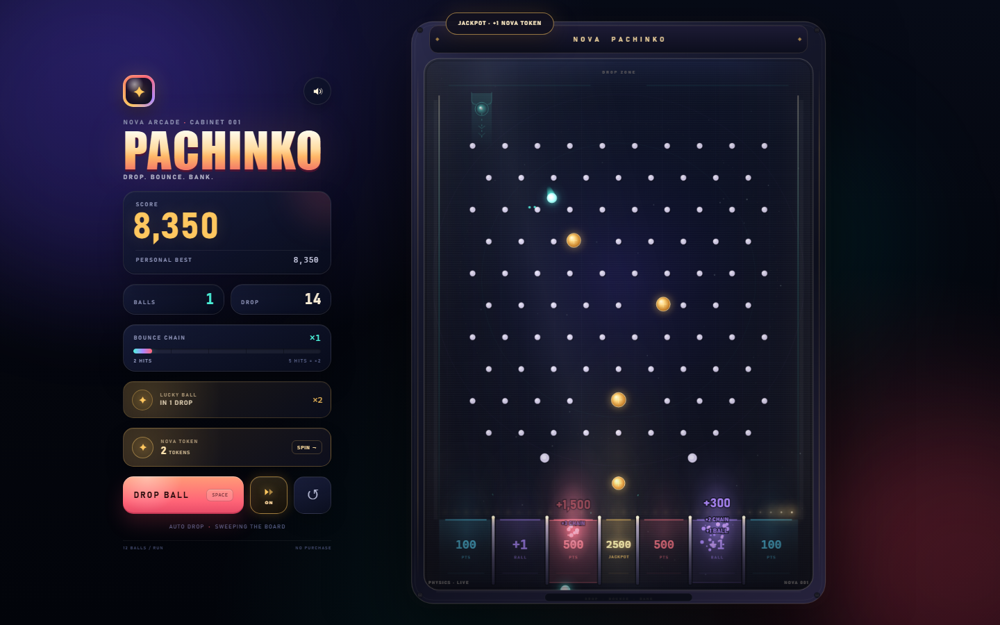
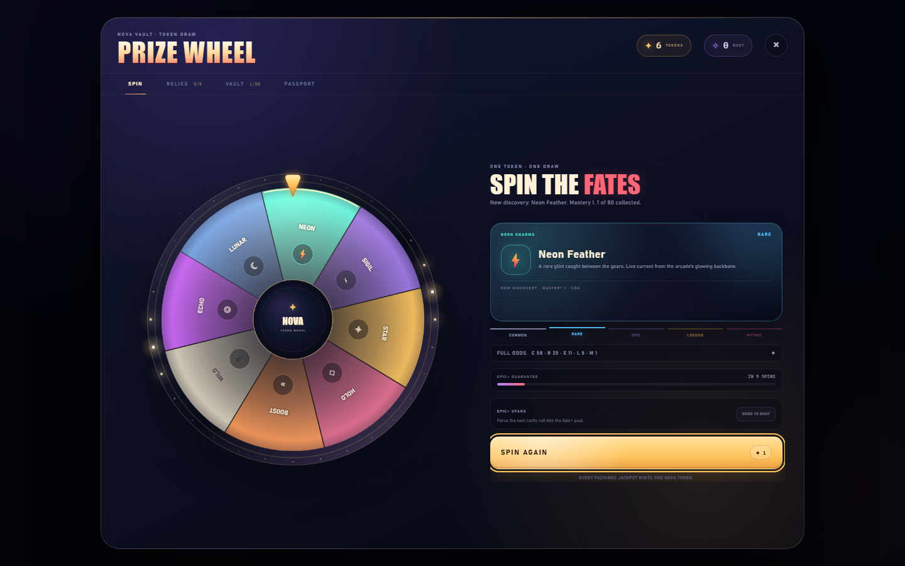
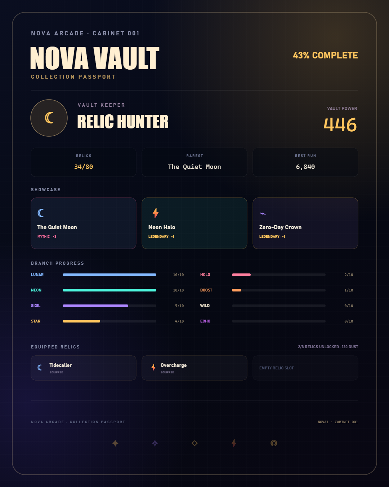

# Nova Pachinko & the Nova Vault

**Play it:** <https://appleknife.github.io/nova-pachinko/> — no install, no build step, works on desktop and phone. Add it to your home screen and it opens full-screen like an app.

A neon arcade pachinko game with a full collection layer underneath: jackpots mint tokens, tokens spin a prize wheel, every wheel branch contains a mini-gacha of collectible placeholder rewards, and duplicates build mastery, Dust, relic sets, and a shareable collection passport.

Open [`index.html`](index.html) in a modern browser. No build step, server, or dependencies required.

## How to play

**Pachinko**

- **Aim** by moving the pointer over the board.
- **Drop** with a click/tap on the board, the **Drop Ball** button, or **Space**.
- **Sweep** (the **SWEEP** button, or **A**) toggles auto drop: every remaining ball drops in a rapid stream, then the next run keeps going on its own. While it is on, the chute sweeps steadily across the board so the burst spreads over every slot instead of stacking in one lane, and the pointer stops steering the aim until you switch auto off.
- **R** restarts a run. **M** toggles sound.
- **Render resolution** cycles **auto → high → low** with the gauge button next to restart (or **Q** on a keyboard). It is remembered between visits. Auto is the right choice for almost everyone; use **low** if a device still stutters, **high** if your GPU has headroom and you want maximum sharpness.
- Every run starts with 12 balls by default. The board has a guarded center jackpot, two bonus-ball slots, and chain multipliers for pin hits. Relics can alter the starting count, chain cadence, lucky-ball cadence, score, bonus slots, and jackpot token payout.
- Every fifth ball is gold and doubles its final payout by default.

**The Nova Vault**

- A ball landing in the center **2500 JACKPOT** slot mints **1 Nova Token**.
- New players receive one welcome token on their first visit.
- Open the gold **Nova Token** card in the side panel to enter the prize wheel.
- Spend **1 token** to spin. The wheel chooses 1 of 8 reward branches.
- The selected branch then rolls a rarity and one of its 10 placeholder rewards.
- **Vault** shows all 80 rewards across 8 branches and 5 rarities, with discovery state, duplicate counts, and five-step mastery bars.
- **Duplicates** grant Nova Dust and raise that item's mastery, which increases Vault Power.
- **Epic+ Spark** lets you spend 75 Dust to force the next rarity roll into the Epic+ pool.
- **Relics** unlock when a full 10-item branch set is complete. Equip up to three to modify your runs.
- **Passport** turns your collection into a downloadable share card, a copyable collection code, and a friend-comparison readout.

## Gacha odds

The same rates are available in the wheel under **FULL ODDS**.

| Roll | Rate |
| --- | --- |
| Wheel branch | 8 branches, **12.5%** each |
| Common | **58%** |
| Rare | **25%** |
| Epic | **11%** |
| Legendary | **5%** |
| Mythic | **1%** |
| Item inside the chosen branch + rarity | 2 items, **50% / 50%** |
| One specific Common item | 12.5% × 58% × 50% = **3.625%** |
| One specific Rare item | 12.5% × 25% × 50% = **1.5625%** |
| One specific Epic item | 12.5% × 11% × 50% = **0.6875%** |
| One specific Legendary item | 12.5% × 5% × 50% = **0.3125%** |
| One specific Mythic item | 12.5% × 1% × 50% = **0.0625%** |

**Pity:** if a streak reaches 9 spins without an Epic or better, the 10th spin's normal rarity roll is replaced with a guaranteed Epic+ roll. The guarantee pool is **Epic 82%, Legendary 15%, Mythic 3%**. After any Epic+ result, the streak resets. An armed **Epic+ Spark** uses the same guarantee pool.

**Token drops are not a fixed RNG rate.** A token is earned whenever a ball lands in the center jackpot; that frequency emerges from the board geometry, aiming, and physics. The **Encore** relic can add +1 token to each jackpot.

## Collection depth

- **Mastery:** an item gains mastery at 1, 2, 3, 5, and 8 copies. Each level adds to Vault Power.
- **Dust:** duplicate rewards grant Dust based on rarity: 4 / 10 / 25 / 60 / 150 for Common through Mythic.
- **Showcase:** click discovered Vault cards to choose up to three favorites for the passport.
- **Titles:** collection progress unlocks titles from Rookie Curator to Vault Sovereign.

## Relic loadout

Completing every item in a branch unlocks its set relic:

| Branch | Relic | Effect |
| --- | --- | --- |
| Lunar | Tidecaller | +1 starting ball each run |
| Neon | Overcharge | Chain tiers every 4 hits instead of 5 |
| Circuit | Goldwire | Gold pins add +3 chain hits |
| Star | Lucky Orbit | A lucky gold ball every 4th drop |
| Holo | Prism Finish | +15% score from every slot |
| Boost | Overflow | Bonus slots add +1 extra ball |
| Wild | Double or Nothing | Bonus-slot points are doubled |
| Echo | Encore | Jackpots mint +1 extra Nova Token |

Equip up to three relics. Changes apply to the next run.

## Nova Passport

The passport tab includes:

- A generated PNG collection card suitable for sharing
- Favorite showcase items, rarest relic, Vault Power, best run, title, branch progress, and equipped relics
- A compact collection code that a friend can paste into their own cabinet to compare discovered counts, Vault Power, and unique relics

All sharing works locally; there is no account or server.

## On a phone

- The layout is sized for a thumb, and double-tapping no longer zooms the page (pinch-zoom is still there when you want it).
- The small arcade type in the HUD and the vault gets one step larger below 860 px, so labels stay readable at arm's length without turning the cabinet into a generic mobile card stack.
- Render resolution defaults to a capped 1.75× backing store on touch devices, with the **RES** button available if a device still stutters.

## Other rules

- **Gold pins** count as two bounce-chain hits, bounce livelier, and light up when struck. Each run rolls a fresh set of four lucky pins — three of the four big deflectors plus one random regular pin — so the hot lanes move from run to run instead of being memorized.
- **Every fifth drop** is a lucky gold ball worth ×2 on its slot payout, unless a relic changes the cadence.
- **Bonus slots** add a ball back to the run.
- **Auto drop** is always available from the first run — it is a pace control, not a collection unlock.
- The 80 individual rewards are intentionally placeholder loot; their mastery and Dust feed the meta systems, while full branch sets unlock real relic effects.

## Feel & feedback

- Pin notes climb a pentatonic scale as a ball's chain grows, so long bounces turn into a little melody.
- Each ball sings in its own register (root, fifth, octave) and pans by its position on the board, so twelve balls in flight read as a chord spread across the stereo field instead of one unison pitch.
- Hit brightness follows impact: soft taps are dull and quiet, hard hits are bright and short. A shared master bus with glue compression and a short plate tail keeps a burst of pin hits from clipping or turning to hiss.
- New chain tiers get an on-board callout and a brighter HUD pulse.
- The board is lit like a parlor cabinet: every pocket glows in its own slot color, the center jackpot tower breathes gold, and a chase of 34 bulbs runs above the payout rail — slow at rest, brisk while balls are dropping, and sprinting when a jackpot is being decided.
- Each ball carries a halo that brightens with its speed, pin hits bloom where they land, and the inner glass walls catch the marquee light while a slow reflection drifts across the cover, so the playfield reads as a lit box instead of a flat plane.
- The wheel bezel's 32 bulbs are two comets that idle, race while the wheel spins, and bloom around the pointer when a result lands.
- The wheel table is lit by a warm lamp: light pools around the bezel, falls across the top of the disc, and catches a few slow motes of dust drifting through it.
- Opening the vault brings up its own room tone — a filtered low pad that breathes, a whisper of air, and an occasional soft chime from the shelves, so the wheel never sits in silence.
- Spinning adds a band of air sweeping upward under the ticks, each tick now has a wooden body under the click, and the wheel settles with a low thud and an airy tail. The reward card gets a paper hush as it is set down.
- Rare pulls escalate instead of just showing a different label. **Legendary** adds a sub thud under the chord, a run of sparkles, a breath of air, a gold flash across the screen, a single sweep of light over the reward card, and a haptic double-tap.
- **Mythic** gets its own production: a pink screen flash that pulses twice, two spark bursts plus a widening shockwave across the disc, a detuned choir holding under the arpeggio, a shimmer sweep, a cascade of high notes falling like sparks, an encore chord a beat later, a double sweep of light over the card, a pulsing card glow, a pink toast, and a longer haptic pattern. It is 1% for a reason, and the room is already quiet when it lands.
- In the last second of a spin the room tone ducks away and a held **G** blooms underneath — the dominant of the C-major reveal — so the landing chord and the rarity roll resolve out of a pocket of quiet instead of over a busy room. The lamp dims with it, so the landing flash has somewhere to bloom from.
- Switching vault tabs gives a soft two-note page-turn instead of a UI beep.
- Lighting eases down to half brightness when a run is over, so the cabinet still glows while the run report waits.
- A ball entering the real center-jackpot lane triggers a short slow-motion tension beat with a filtered noise riser underneath. There is no scripted or fake near-miss — it only happens when the physics takes the ball there.
- Jackpots launch a gold token across the screen into the Nova Token card, over a sub thump and a blooming chord.
- The wheel's rim ticks drop in pitch and gain weight as it slows, the way a real wheel does, then flicker through rarity colors before locking the result.
- The light chase slows or freezes under `prefers-reduced-motion`, and the glass reflection and drifting dust are skipped entirely.
- Muting suspends the audio graph, so reverb tails and ringing chords stop instantly instead of decaying.
- Motion-heavy extras respect `prefers-reduced-motion`.

## Run report

The run-complete card now shows:

- Jackpots hit
- Nova Tokens earned during the run
- Best chain multiplier
- Overall vault progress
- The nearest unfinished set and how many items it still needs
- A **Spend N Tokens** shortcut into the wheel when your wallet has tokens, or **View Vault** when it does not

## Persistence

The browser saves:

- best pachinko score
- sound preference
- Nova Token wallet
- pity counter
- spin count
- collection counts and mastery for all 80 rewards
- Nova Dust
- equipped relic loadout
- showcase picks
- armed Epic+ Spark state
- the one-time welcome token flag
- whether auto drop is on

No server or account is involved.

## Under the hood

The pachinko simulation runs at a fixed 240 Hz step, independent of display refresh rate:

- circle-vs-circle collisions for pins and ball-to-ball contact
- capsule collisions for slot dividers and outer rails
- impulse responses with restitution, tangential friction, and tiny collision noise to avoid symmetric dead paths
- boundary constraints and an anti-stuck nudge
- guard pins above the center slot to keep the jackpot rare

Lighting is a single additive pass (`globalCompositeOperation = "lighter"`) over the board: pocket wells, the jackpot tower, the rail chase, ball halos, pin blooms, and the glass reflection all draw cached radial-gradient and band sprites instead of building gradients every frame, so roughly ninety light blits per frame stay cheap.

Performance is budgeted per device. The canvas backing store is capped (1.75× on touch devices, 2× on desktop) and an adaptive controller measures frame times: if frames run long it steps the render scale down, and once there is headroom it creeps back up. The **RES** button (or **Q**) overrides that guess (auto → high → low, remembered between sessions) for machines where the automatic choice is wrong. The cabinet, glass glare, trim, and the scanline texture are baked once and blitted, and every static gradient is cached, so a frame is just the playfield, the balls, and the additive light pass.

Just as important, nothing expensive is left in CSS on an animating layer: the cabinet shadow is a `box-shadow` rather than a `drop-shadow` filter, the background orbs are soft gradients rather than a blurred container, and the vault overlay is fully opaque instead of using `backdrop-filter`. Those three were the main cause of frame drops in Safari and on phones, because each one forces a full-screen blur or filter pass every frame. Per-ball and per-pin canvas shadows are gone too; the cached glow sprites do that work.

The wheel's room tone is a small set of long-lived oscillators (a detuned low pad through a low-pass, one slow LFO, and a filtered noise loop) started when the vault opens and faded out when it closes, so it costs nothing while the board is being played.

The prize wheel is drawn to a device-pixel-ratio-aware canvas, with a decelerating spin computed from the target wedge and eased over time. The vault and gacha data are plain JavaScript objects; all sound is synthesized with the Web Audio API.

The game pauses its physics while the wheel overlay is open, then resumes the exact board state when it closes.

## Files

- `index.html` — cabinet UI, prize wheel, and vault shell
- `style.css` — pachinko cabinet and HUD layout
- `game.js` — board physics, scoring, particles, audio, and rendering
- `wheel.css` — prize wheel, vault, relic, and passport presentation
- `wheel.js` — token wallet, Dust, mastery, relics, rarity rolls, pity, passport, and collection
- `preview.png` — pachinko gameplay preview
- `preview-wheel.png` — prize wheel preview
- `preview-passport.png` — exported collection passport example
